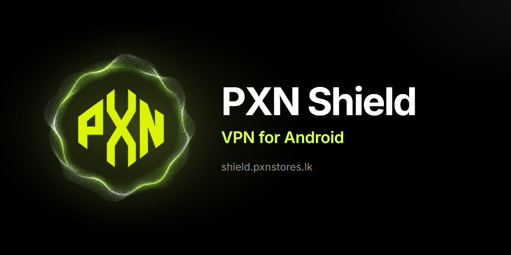
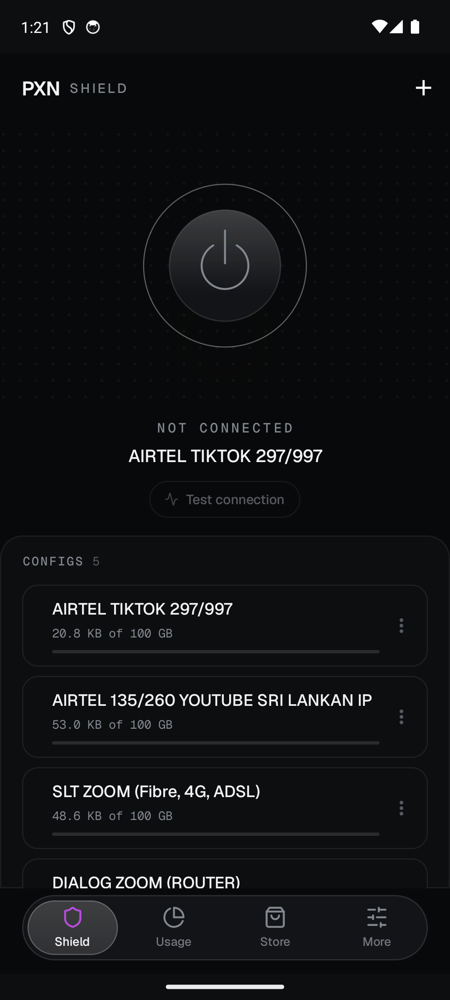
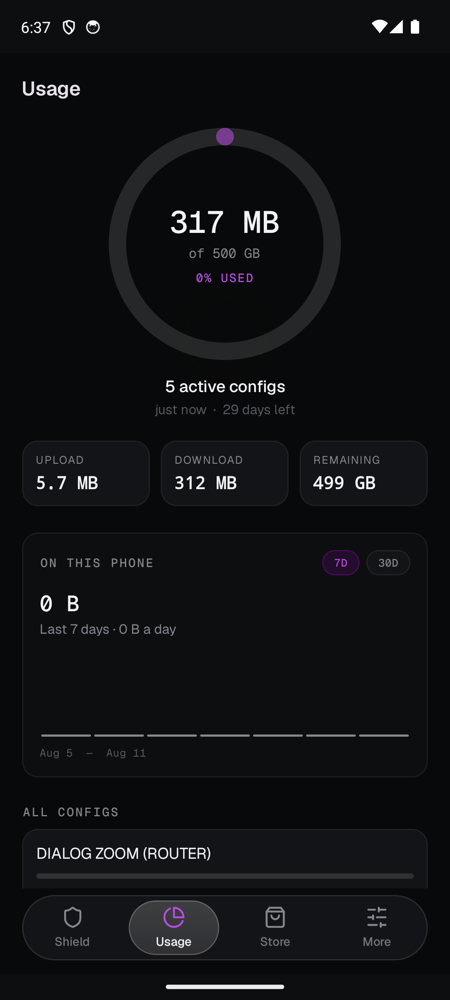
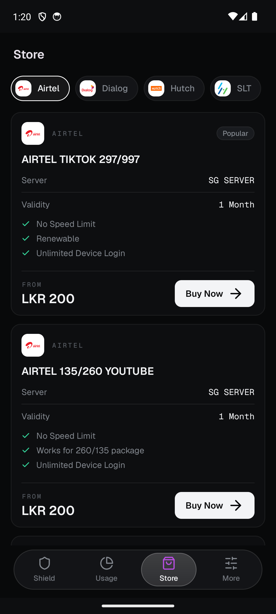
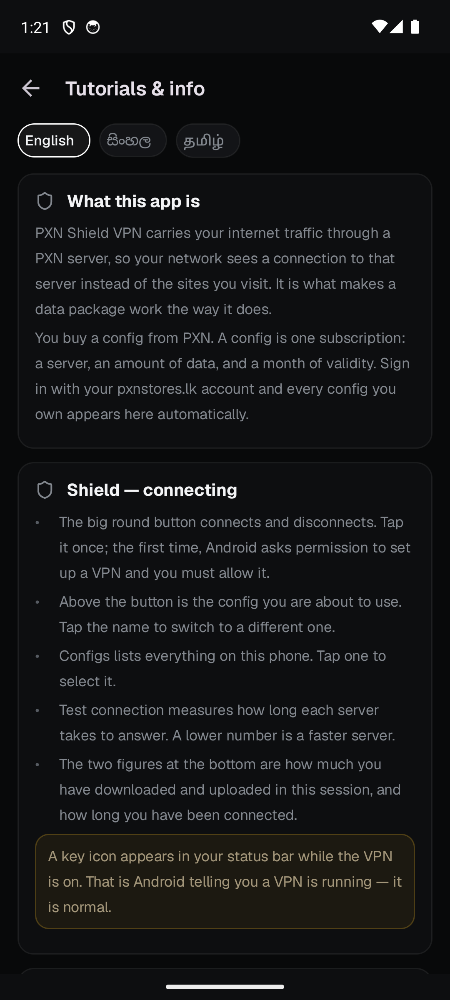

  

### [⬇ Download for Android][latest]

Android 7.0 or newer · free with any [PXN Stores][site] plan

 

---

## What this is

The Android client for **[PXN Stores LK][site]**.

Sign in with the account you bought your plan on and every config you own is
already there — no links to paste, no files to import, no QR codes to scan.

## What it does

|  |  |
|---|---|
| 🔑 **Configs arrive with your account** | Sign in with email or Google. Buy another plan and it appears on the next sync. |
| 📊 **See what you have left** | Used against allowance and days remaining, per config and across the account — the same numbers as your order page. |
| 🛒 **Buy and renew in the app** | Pick a network, a package and how much data, pay, attach the slip. It lands in your purchase history exactly as a website order would. |
| 🌐 **Routing you can change** | Cloudflare Warp+ or a Sri Lankan IP, without opening the website. |
| 📱 **Per-app split tunnelling** | Choose which apps go through the tunnel and which go direct. |
| 📈 **What this phone moved** | 7-day and 30-day charts, measured locally as the tunnel runs. |
| ⚡ **Quick Settings tile** | Connect and disconnect from the notification shade. |
| 📖 **Guides** | English, සිංහල and தமிழ், under **More → Tutorials & info**. |

No account? You can skip sign-in and add configs by hand from the clipboard.
They stay on the phone.

## Installing

Android does not install apps from outside the Play Store by default. The first
time, it asks you to allow your browser or file manager to install apps — that
prompt is the system's, and you can revoke it afterwards.

1. Open the [latest release][latest].
2. Download the right file:

   | File | Use it if |
   |---|---|
   | `..._arm64-v8a.apk` | Your phone was made in roughly the last eight years. **Start here.** |
   | `..._armeabi-v7a.apk` | Your phone is older, or arm64 refuses to install. |
   | `..._universal.apk` | You are not sure. Larger, but works everywhere. |

3. Open the downloaded file and confirm.
4. On first connect, Android asks permission to set up a VPN. Every VPN app on
   Android does this.

> **Only download from [the releases page here][latest].** A PXN Shield APK from
> anywhere else was not built by us.

The app does not update itself — **About → Check for updates** opens the
releases page. Installing a newer APK over an older one keeps your configs and
your sign-in.

## Privacy

The app talks to two places: your PXN account, to fetch the configs you own and
their usage, and whichever server you connect to. Browsing is not logged,
recorded or sent anywhere by the app.

Full policy: [pxnstores.lk/privacy][privacy]

## Help

- 💬 **WhatsApp** — [+94 76 154 6544][whatsapp]
- 📖 **Setup guides** — [pxnstores.lk][guides]
- 🐛 **Bugs and requests** — [open an issue][issues]

## Also available

| | |
|---|---|
| **Android** | you are here |
| **Linux** | [pxn-shield-linux][linux] |
| **Windows** | [pxn-shield-windows][windows] |

---

Built by **[PXN Stores LK][site]** in Colombo · [Every release][releases]

This repository is the download page. The application source is not published here.
Third-party licences are listed in the app under **About → Open Source licenses**.

[latest]: https://github.com/NightRiderr77/pxn-shield-android/releases/latest
[releases]: https://github.com/NightRiderr77/pxn-shield-android/releases
[issues]: https://github.com/NightRiderr77/pxn-shield-android/issues
[linux]: https://github.com/NightRiderr77/pxn-shield-linux
[windows]: https://github.com/NightRiderr77/pxn-shield-windows
[site]: https://www.pxnstores.lk
[privacy]: https://www.pxnstores.lk/privacy
[guides]: https://www.pxnstores.lk/v2ray/setup-guides
[whatsapp]: https://wa.me/94761546544
